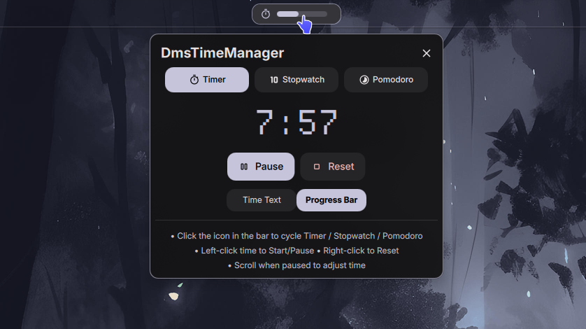

# DmsTimeManager

Timer, Stopwatch & Pomodoro — all-in-one time manager for DankMaterialShell.



## Features

- **3 modes** — Timer (countdown), Stopwatch (count-up), Pomodoro (work/break cycles)
- **Progress bar or numeric time** — switch between a smooth progress bar or classic `HH:MM:SS` display directly in the popout
- **Cycle modes via icon** — click the mode icon in the bar to cycle Timer → Stopwatch → Pomodoro
- **Drift-free timing** — uses `Date.now()` under the hood for accurate time tracking across all bar instances
- **Sound alarm** — plays a notification sound on timeout via `paplay` or `canberra-gtk-play`
- **Desktop notifications** — `notify-send` at timeout
- **Auto DND** — optionally enables Do Not Disturb while the timer is running
- **Cross-monitor sync** — timer state is shared across all bar instances via `PluginGlobalVar`
- **IPC** — control via `dms ipc call timeManager <command>`
- **Settings** — fully configurable via DMS Settings UI (default times, pomodoro durations, sounds, notifications)

## Installation

```bash
# Clone the repo into your plugins directory
git clone https://github.com/Zhainy/DmsTimeManager.git ~/.config/DankMaterialShell/plugins/DmsTimeManager

# Restart DMS
dms restart
```

### Enable

1. Open DMS Settings → Plugins → Scan for Plugins
2. Toggle **DmsTimeManager** on
3. Add it to your DankBar widget list
4. Restart DMS

### Dependencies

- **Runtime**: `paplay` (comes with PipeWire/PulseAudio — pre-installed on most systems)
- **Optional — default alarm sound**: `canberra-gtk-play` (`libcanberra` package) for the default notification sound

```bash
sudo pacman -S libcanberra  # Arch Linux
```

Without `libcanberra`, set a custom sound file path in the plugin settings.

## Usage

| Action | Result |
|--------|--------|
| Click mode icon | Cycle through Timer / Stopwatch / Pomodoro |
| Left-click time/progress bar | Start / Pause |
| Right-click pill | Reset / Stop |
| Scroll wheel (when paused, Timer mode) | Adjust time by ±1 minute |
| Open popout | Full controls: mode tabs, presets, custom input, segmented button for Time Text / Progress Bar |

### Pomodoro

The pomodoro mode follows a work → short break → long break cycle:

- Work: configurable (default 25 min)
- Short break: configurable (default 5 min)
- Long break: after N sessions (default 4)
- Auto-advance: optionally starts the next phase automatically

### IPC

```bash
# Get status
dms ipc call timeManager status
dms ipc call timeManager getStatus

# Control
dms ipc call timeManager toggle
dms ipc call timeManager pause
dms ipc call timeManager resume
dms ipc call timeManager reset

# Switch mode
dms ipc call timeManager mode timer
dms ipc call timeManager mode stopwatch
dms ipc call timeManager mode pomodoro

# Start timer with custom minutes
dms ipc call timeManager startTimer 15
```

## Settings

Configure via DMS Settings → Plugins → DmsTimeManager:

- **Timer**: Default time (1–120 min)
- **Pomodoro**: Work duration, short break, long break, sessions before long break, auto-start
- **Sound**: Custom sound path (WAV/OGG/MP3), use system sound
- **Notifications**: Desktop notification on timeout, auto DND
- **Display**: Show icon in bar, bar display mode (Time Text / Progress Bar)

## Compatibility

- **Compositors**: Niri, Hyprland (any Wayland compositor supported by DMS)
- **Distro**: Any (Arch Linux, Fedora, etc.)
- **DMS version**: ≥ 1.2.0

## Author

[Zhainy](https://github.com/Zhainy)

## License

MIT
